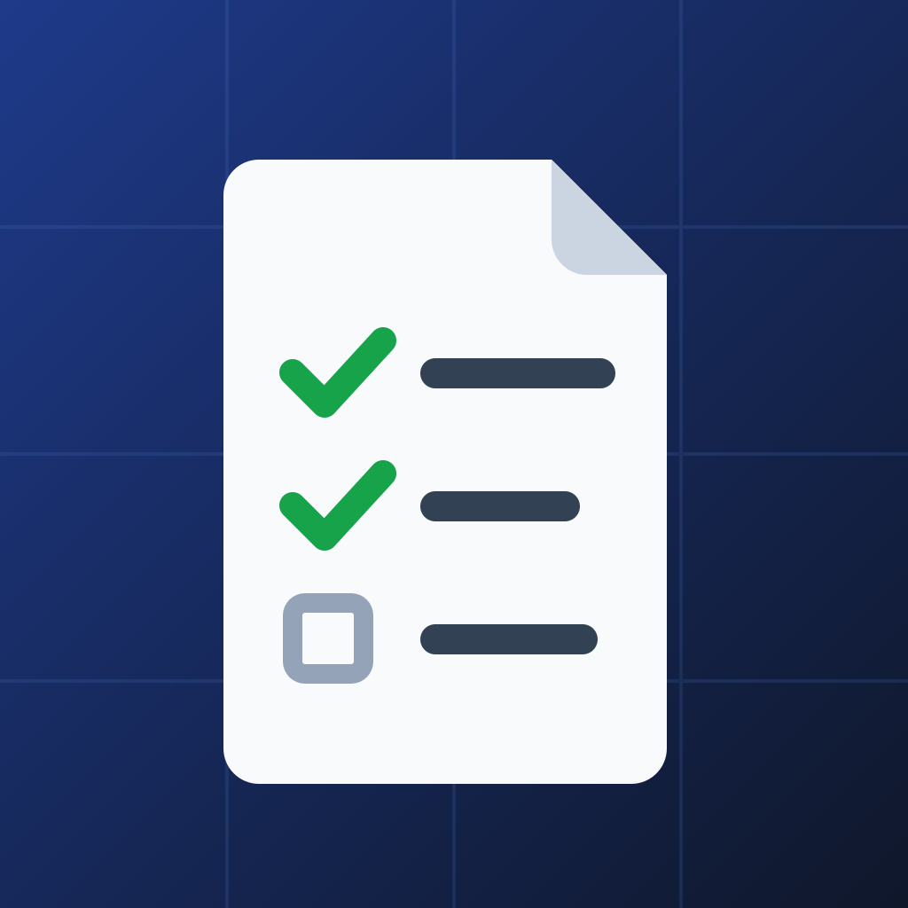

<p align="center">
  
</p>

<h1 align="center">PRP Manager</h1>

<p align="center">
  An <a href="https://agentskills.io">Agent Skill</a> for creating and executing PRPs (Product Requirements Prompts) using Context Engineering principles for one-pass implementation success.
</p>

<p align="center">
  <a href="https://skills.sh/willywg/prp-manager"></a>
  <a href="LICENSE"></a>
</p>

Works with Claude Code, Cursor, Codex, Grok Build, Gemini CLI, GitHub Copilot, VS Code, OpenCode, and [other compatible agents](https://agentskills.io/clients).

```bash
npx skills add https://github.com/willywg/prp-manager --skill prp-manager
```

Listed on [skills.sh](https://www.skills.sh/willywg/prp-manager/prp-manager) and in the official Claude plugin directory (Claude Code, Cowork and the Claude apps).

## What is Context Engineering?

Context Engineering is a discipline for providing AI coding assistants with comprehensive information needed to complete tasks end-to-end. Unlike traditional prompt engineering (which focuses on clever wording for individual tasks), Context Engineering is a complete system including documentation, examples, rules, patterns, and validation mechanisms.

> "Most agent failures aren't model failures - they're context failures."

## What are PRPs?

**PRPs (Product Requirements Prompts)** are comprehensive implementation blueprints specifically designed for AI coding assistants. They are similar to traditional PRDs (Product Requirements Documents) but crafted to instruct AI rather than human teams.

A PRP provides the AI with:
- **Product Requirements**: What you're building and why
- **Curated Codebase Intelligence**: Examples, existing patterns, and conventions
- **Agent Runbook**: Step-by-step instructions including testing and validation

## Features

- **Initialize**: Analyzes your project and creates a customized PRP template based on your stack (Python/Node.js/etc.), linting tools, testing framework, and project conventions
- **Generate**: Creates comprehensive PRPs for new features with all necessary context
- **Execute**: Implements features following the PRP with validation loops

## Installation

### Any compatible agent (Recommended)

Install with the [skills CLI](https://www.skills.sh/willywg/prp-manager/prp-manager), which detects your installed agents and copies the skill to the right location:

```bash
npx skills add https://github.com/willywg/prp-manager --skill prp-manager
```

### Claude Code (Plugin)

PRP Manager is in the official Claude plugin directory. In your shell:

```bash
claude plugin install prp-manager@anthropic-plugin-directory
```

Or find it in the `/plugin` panel inside a session. Update later with `claude plugin update prp-manager@anthropic-plugin-directory`.

The directory serves each version after Anthropic reviews it. To get new versions as soon as they are pushed, install from this repository, which is also a plugin marketplace:

```bash
claude plugin marketplace add willywg/prp-manager
claude plugin install prp-manager@prp-manager
```

Or inside a session, in one step (Claude Code 2.1.275 or later):

```
/plugin install prp-manager --marketplace willywg/prp-manager
```

Notes:
- As a plugin, the skill is invoked explicitly as `/prp-manager:prp-manager`. Automatic activation works the same as with any other install.
- Pick one install method: the directory or this repository's marketplace, not both. If you also have the skill in `~/.claude/skills/` (from `npx skills add` or a manual copy), Claude Code loads the plugin and skips that copy. Remove the copy to avoid confusion.

### Claude Code (Manual)

```bash
# Clone the repository
git clone https://github.com/willywg/prp-manager.git
cd prp-manager

# Option 1: User-level (available in all projects)
mkdir -p ~/.claude/skills
cp -r prp-manager ~/.claude/skills/

# Option 2: Project-level (available only in current project)
mkdir -p /path/to/your/project/.claude/skills
cp -r prp-manager /path/to/your/project/.claude/skills/
```

After installation, verify the skill is available:
```bash
# In your Claude terminal:
/reload-skills
```
The `prp-manager` skill should be listed.

### Claude.ai (Web)

1. Download this repository as a ZIP
2. Extract and compress only the `prp-manager/` folder into a new ZIP
3. Go to **Settings > Features**
4. Upload the ZIP file

> Note: Custom Skills on Claude.ai require Pro, Max, Team, or Enterprise plans with code execution enabled.

### Claude Desktop

1. Download this repository as a ZIP
2. Extract and compress only the `prp-manager/` folder into a new ZIP
3. Open Claude Desktop settings
4. Navigate to the Skills section
5. Upload the ZIP file

## Usage

The skill activates automatically when you mention PRPs or feature planning.

### Workflow 1: Initialize PRPs (Recommended First)

```
User: "Initialize PRPs for this project"
```

Claude will:
1. Analyze your project files (README, package.json, CLAUDE.md, etc.)
2. Detect your stack and conventions
3. Create `PRPs/templates/prp_base.md` customized for your project

### Workflow 2: Generate a PRP

```
User: "Create a PRP for adding OAuth authentication with Google"
```

Claude will:
1. Research your codebase for similar patterns
2. Gather external documentation if needed
3. Create `PRPs/001--google-oauth.md` with full context

### Workflow 3: Execute a PRP

```
User: "Execute PRP PRPs/001--google-oauth.md"
```

Claude will:
1. Read and understand the PRP
2. Implement tasks in order
3. Run validation at each step
4. Report completion status

## Example Output

### After Initialize
```
PRPs Initialized for MyProject

Stack Detected:
- Language: TypeScript 5
- Framework: Express
- Package Manager: pnpm
- Linting: Biome
- Type Checking: tsc
- Testing: Vitest

Created:
- PRPs/templates/prp_base.md

Ready to generate PRPs!
```

### After Generate
```
PRPs/005--feature-name.md

Confidence: 8/10
Key Notes: [implementation highlights]
```

### After Execute
```
PRP Execution Complete

Tasks: 5/5 completed
Validation: All passing
Status: SUCCESS
```

## Stack Detection

During initialization, Claude analyzes your project files to detect your stack and create an appropriate PRP template with the correct validation commands. The table below shows common configurations, but **Claude will adapt to whatever stack your project uses**.

| Stack | Package Manager | Linting | Testing |
|-------|----------------|---------|---------|
| Python | uv, pip | ruff, flake8, mypy | pytest |
| Node.js | npm, pnpm, yarn | eslint, biome | jest, vitest |
| TypeScript | npm, pnpm | tsc, biome | jest, vitest |
| Go | go modules | gofmt, go vet | go test |
| Rust | cargo | cargo fmt, clippy | cargo test |

### Recommended: Provide Project Context

For best results, ensure your project has one or more of these files before initializing PRPs:

- **`CLAUDE.md`** or **`AGENTS.md`** - AI agent instructions and project rules
- **`README.md`** - Project overview and architecture
- **`CONTRIBUTING.md`** - Code style and contribution guidelines

These files give Claude more context about your project's conventions, patterns, and specific requirements, resulting in better customized PRP templates.

## Repository Structure

```
prp-manager/                  # Repository root
├── README.md                 # This file
├── LICENSE                   # MIT License
├── CLAUDE.md                 # Claude Code guidance for this repo
├── .claude-plugin/
│   └── marketplace.json      # Claude Code plugin marketplace (points at the skill)
├── PRPs/                     # PRPs used to develop this repo
├── evals/                    # Trigger eval for the skill description
└── prp-manager/              # The skill (copy this folder)
    ├── .claude-plugin/
    │   ├── plugin.json       # Claude Code plugin manifest
    │   └── icon.png          # Plugin directory listing icon
    ├── SKILL.md              # Main skill instructions
    ├── assets/
    │   └── templates/
    │       └── prp_base.md   # Default PRP template
    └── references/
        ├── examples.md       # Usage examples
        └── customization.md  # Stack-specific customization guide
```

## Credits & Inspiration

This skill is based on the Context Engineering methodology:

- **PRP Framework**: Originally created by [Rasmus Widing (Wirasm)](https://github.com/Wirasm/PRPs-agentic-eng)
- **Context Engineering**: Popularized by [Cole Medin](https://github.com/coleam00) in [context-engineering-intro](https://github.com/coleam00/context-engineering-intro)

## Learn More

- [Agent Skills Specification](https://agentskills.io/specification)
- [PRP Manager on skills.sh](https://www.skills.sh/willywg/prp-manager/prp-manager)
- [What is Context Engineering?](https://github.com/coleam00/context-engineering-intro)
- [Original PRP Framework](https://github.com/Wirasm/PRPs-agentic-eng)

## License

MIT License - see [LICENSE](LICENSE) file for details.
